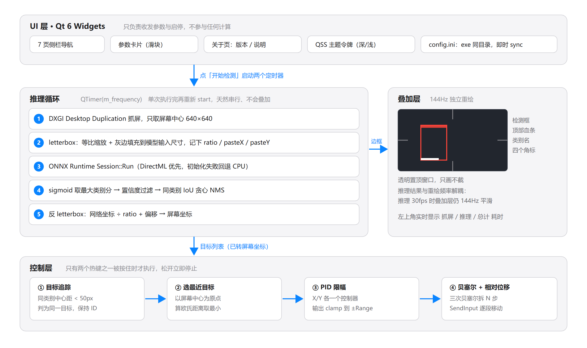
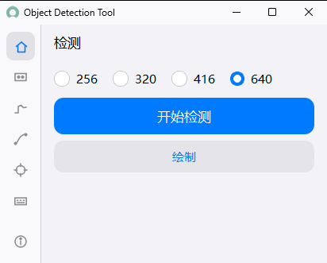
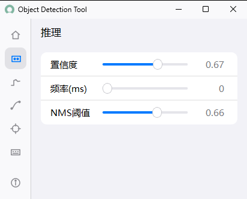
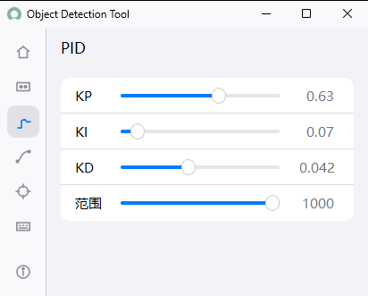
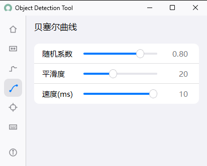
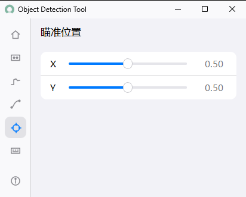
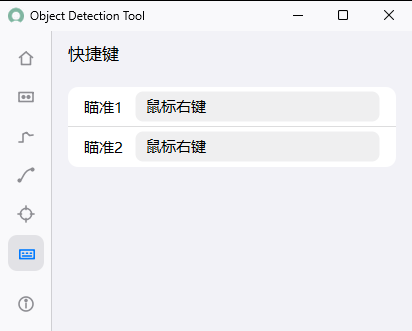
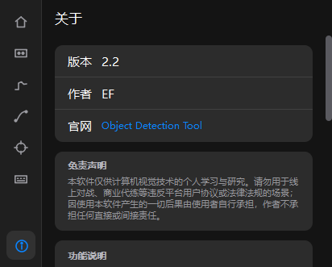
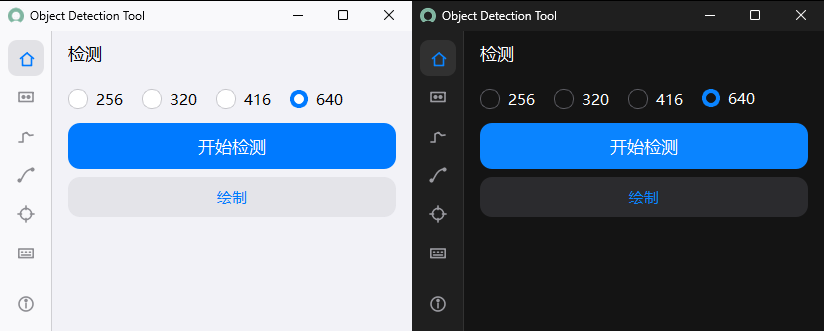

# Object Detection Tool 2.2

**抓屏幕中心的一块画面 → 跑目标检测 → 把框画回屏幕上 → 按住某个键时，把鼠标朝目标方向推一点。**

纯 C++ / Qt 实现，不需要 Python、不需要 CUDA。抓屏走 DXGI Desktop Duplication，推理走 ONNX Runtime（DirectML），绘制是一个透明置顶的 Qt 窗口，参数全部落在 exe 同目录的 `config.ini`。

- **平台**：Windows 10 / 11 x64
- **技术栈**：C++20 · Qt 6.5.1 Widgets · CMake + Ninja · ONNX Runtime 1.22.1（DirectML）
- **实测环境**：Intel i5-12400F ／ NVIDIA RTX 3060 ／ 16 GB DDR4 ／ Windows 11 26200 ／ 1920×1080
- **规模**：C++ 源码约 3200 行，产物是一个 exe + 若干 DLL
- **版本**：2.2

## 整体架构

[](docs/images/01-architecture.png)

一共有四条线路，其中后两条才是真正决定能不能用的：

| 线路 | 职责 | 实现要点 |
| --- | --- | --- |
| UI 层 | 收发参数、启停检测 | Qt Widgets，改完参数立即落盘，不参与计算 |
| 推理循环 | 抓屏 → 预处理 → 推理 → 后处理 | DXGI 抓 D3D11 纹理 → letterbox → ONNX Runtime/DirectML → sigmoid + 阈值 + 同类别 NMS |
| 控制层 | 把检测结果换算成鼠标位移 | 热键闸门 → 目标锚点到屏幕中心的误差 → PID → 贝塞尔拆步 → SendInput 相对位移 |
| 叠加层 | 只画不算，独立 144 Hz 重绘 | 透明置顶窗口，带 `WDA_EXCLUDEFROMCAPTURE`，**不参与抓屏** |

叠加层这一条容易被忽略，但它是整套工具能自洽的前提：如果画在屏幕上的检测框被下一帧抓回去当输入，就会形成自反馈——框被当成画面内容喂给模型，模型在框上再出框，两秒钟就"实"成一块色块。所以叠加窗口建出来就声明自己不进任何屏幕采集，人眼看得见、抓屏看不见。同理，抓屏只对 640×640 那一小块在 GPU 内做一次纹理拷贝，不走 GDI 整屏拷贝，也就不怕自己在全屏上重绘。

## 界面与功能

### 检测页



左边 7 个导航项（检测 / 推理 / PID / 贝塞尔曲线 / 瞄准位置 / 快捷键 / 关于），右边是当前页。

检测页只有三样东西：模型输入尺寸（256 / 320 / 416 / 640）、`开始检测`、`绘制`。

尺寸这一档值得单独解释：**抓屏区域是固定的 640×640**，尺寸选的是"这块画面送进模型前缩到多大"，所以四档真正的差别体现在每帧推理要花多少毫秒上。

### 六个功能页

| 推理 | PID |
| :---: | :---: |
|  |  |
| **贝塞尔曲线**<br> | **瞄准位置**<br> |
| **快捷键**<br> | **关于**<br> |

几个设计上的取舍：

- **参数改完立即落盘**，不需要点保存，进程被强杀也不丢。
- **热键框是"点一下才进监听"**，不是一获得焦点就开始录键，避免切页面路过输入框时误改。
- **两个热键完全等价**，可以按手型设成右键、侧键，或者两个都设。
- **`范围`** 是单帧最大移动像素，滑块满值 1000 等于不限幅。
- **`速度`** 这个参数名字有点反直觉：它的实际含义是这一整段位移的**总耗时**（毫秒），所以调大"速度"鼠标反而变慢。
- **瞄准位置** 的 X / Y 是命中点在检测框内的相对位置，`0.5 / 0.5` 就是正中；X 越大越靠右，Y 越大越靠上。

### 深浅两套主题



默认跟随系统（读注册表 `AppsUseLightTheme`，并监听 `WM_SETTINGCHANGE` 实时切换），也可以在 `config.ini` 里写死 `theme=light` / `theme=dark`。

深色不是简单地把白底反色：外壳 `#1f1f1f`、内容页 `#141414`、卡片 `#2c2c2c`，层次比纯黑舒服。标题栏也不是自绘的假壳，是用 DWM 的 `DWMWA_CAPTION_COLOR` 染的真标题栏，所以最小化 / 关闭按钮、拖拽、贴边分屏全是系统原生行为。

## 性能

本机（i5-12400F / RTX 3060 / DirectML）实测，抓屏 640×640，频率设为 0（跑满为止），每档取 600~1400 帧的中位数：

| 输入尺寸 | 单帧推理 | 整条循环帧率 |
| --- | --- | --- |
| 256 | 2.66 ms | 约 138 fps |
| 320 | 4.16 ms | 约 128 fps |
| 416 | 5.71 ms | 约 102 fps |
| 640 | 10.86 ms | 约 66 fps |

抓屏本身不到 1 ms。640 的耗时约是 256 的 3.8 倍——像素量差 6 倍，但固定开销（抓屏、显存往返、后处理）摊薄了差距。要快选 256，要准选 640。

## 编译与运行

### 依赖

- Qt 6.5+（Widgets）
- CMake 3.24+ 与 Ninja
- ONNX Runtime 1.22.1 DirectML 包（`onnxruntime.dll`、`onnxruntime_providers_shared.dll`、`onnxruntime_providers_dml.dll`、`DirectML.dll`）
- MinGW 或 MSVC 均可

```bash
cmake -G Ninja -B build -DCMAKE_BUILD_TYPE=Release
cmake --build build
```

CMake 的 POST_BUILD 会自动把 Qt 与 ORT 的 DLL 拷到输出目录。模型要自己准备。

### 运行目录

```
efai2_1.exe
config.ini                                  ← 改过任意参数后自动生成；也可以自己新建
onnxruntime.dll
onnxruntime_providers_shared.dll
onnxruntime_providers_dml.dll
DirectML.dll
models/
└─ your_model.onnx                         ← 自备，config.ini 里写相对路径
```

整套运行文件约 58 MB（exe 本体约 550 KB，其余是 Qt 与 ONNX Runtime 的运行库）；模型另算，单个 `.onnx` 约 43 MB。

### 模型

YOLO 系列导出的 ONNX，输出为通道优先的 `[1, 4+类别数, 检测框数]`，置信度是 logits。输入输出尺寸不写死，程序启动时从 session 里读回来，所以换模型、换类别数都不用改代码。

### config.ini

界面上的每一处改动都会立刻写回这个文件，也可以直接改文件（重启生效）。缺失的键一律按默认值走：

```ini
theme=auto

[Capture]
Width=640
Height=640

[Inference]
ModelPath=./models/lqm640.onnx
ConfidenceThreshold=0.7
NmsThreshold=0.45
Frequency=0
GpuDeviceId=0

[Hotkey]
Key=2
Key2=5

[PID]
Kp=1.0
Ki=0.1
Kd=0.05
Range=15

[Bezier]
RandomFactor=0.3
Steps=8
Speed=1

[TargetOffset]
X=0.5
Y=0.5

[DrawWindow]
Visible=true
```

| 键 | 说明 |
| --- | --- |
| `theme` | `light` / `dark` / `auto`（省略即跟随系统） |
| `Capture/Width`、`Height` | 抓屏区域，固定正方形；DPI 缩放下会自动换算成物理像素 |
| `Inference/ModelPath` | 模型相对路径 |
| `Inference/ConfidenceThreshold` | 置信度阈值（模型输出是 logits，程序内部先过 sigmoid） |
| `Inference/NmsThreshold` | 同类别 NMS 的 IoU 阈值 |
| `Inference/Frequency` | 每轮推理后额外等待的毫秒数，`0` 表示不等、跑满为止 |
| `Inference/GpuDeviceId` | DirectML 使用的显卡序号，多显卡时用 |
| `Hotkey/Key`、`Key2` | 两个等价热键，默认鼠标右键与侧键 1 |
| `PID/Kp`、`Ki`、`Kd` | PID 三项，D 项按每帧误差变化率计算，动它比动 P 更敏感 |
| `PID/Range` | 单帧最大移动像素；滑块满值 1000 等于不限幅 |
| `Bezier/RandomFactor` | 曲线随机程度，`0` 退化成直线 |
| `Bezier/Steps` | 一次位移拆成几步走 |
| `Bezier/Speed` | 名字叫速度，实际是这一整段位移的总耗时（毫秒），调大反而变慢 |
| `TargetOffset/X`、`Y` | 命中点在检测框内的相对位置，`0.5/0.5` 为正中；Y 越大越靠上 |
| `DrawWindow/Visible` | 叠加层是否显示 |
| `About/Url` | 关于页显示的开源地址，留空则用代码里写死的仓库地址 |

## 目录结构

```
.
├─ main.cpp                     程序入口、应用名与版本
├─ ScreenCaptureWidget.cpp/.h   主窗口、七个页面、主题、参数读写
├─ ScreenCaptureWidget.ui       检测页控件
├─ dxgi/                        DXGI Desktop Duplication 抓屏
├─ onnxruntime/                 ONNX Runtime 会话与前后处理
├─ mouse/                       热键、PID、贝塞尔、SendInput
├─ draw/                        透明叠加层（不参与抓屏）
├─ assets/                      图标
├─ docs/images/                 README 配图
└─ CMakeLists.txt
```

C++ 源码约 3200 行。

## 免责声明

本软件仅供计算机视觉技术的个人学习与研究使用，请勿用于线上对战、商业代练等违反平台用户协议或法律法规的场景。因使用本软件产生的一切后果由使用者自行承担，作者不承担任何直接或间接责任。

控制功能是"按住热键才生效"的手动触发设计，松开立即停止；检测本身不会移动鼠标。

---

作者：**EF**　｜　[github.com/ef12138/Object-Detection-Tool-Cpp](https://github.com/ef12138/Object-Detection-Tool-Cpp)
